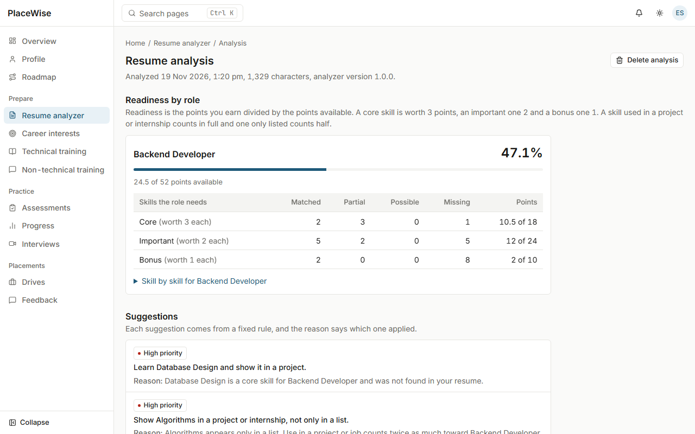
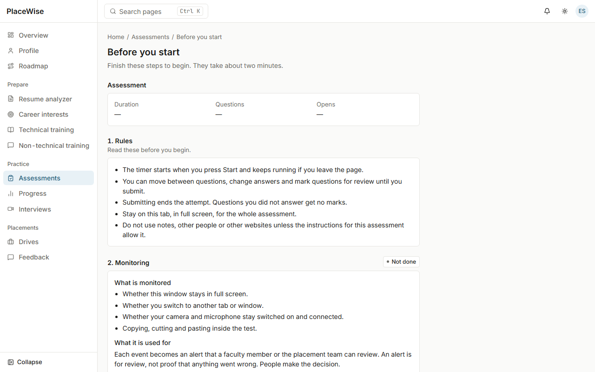
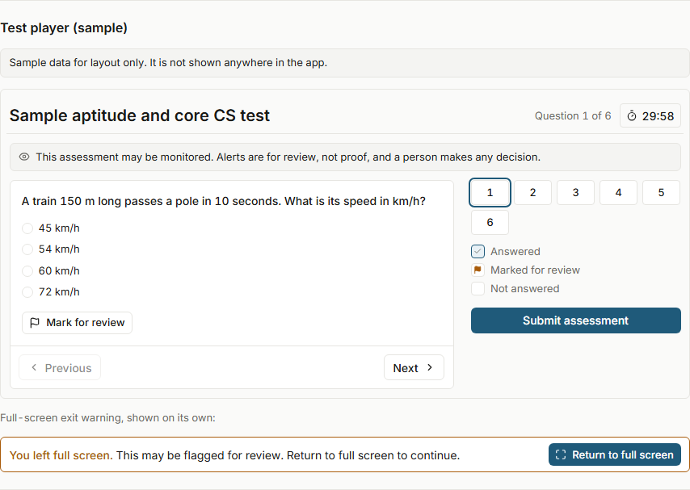
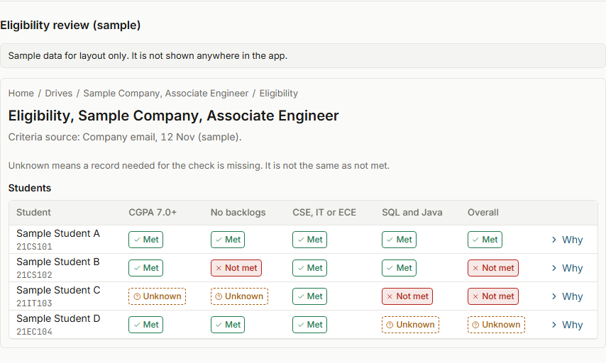
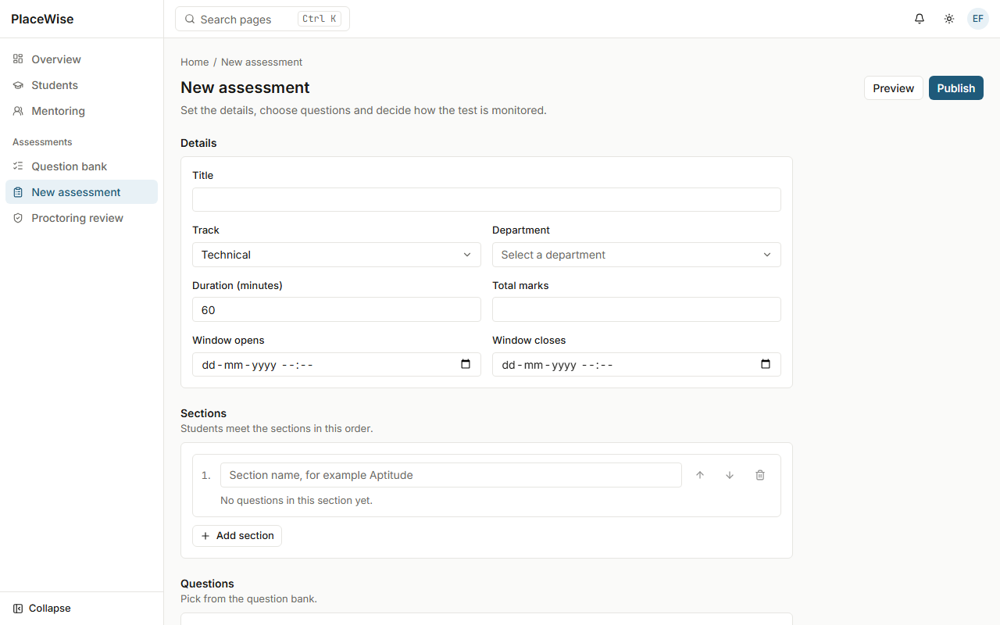
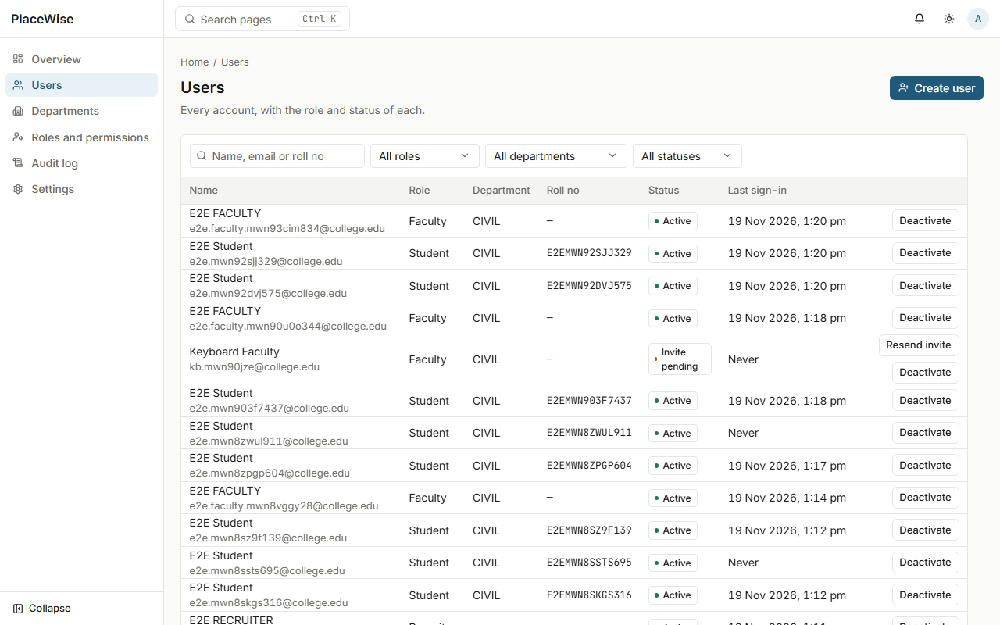
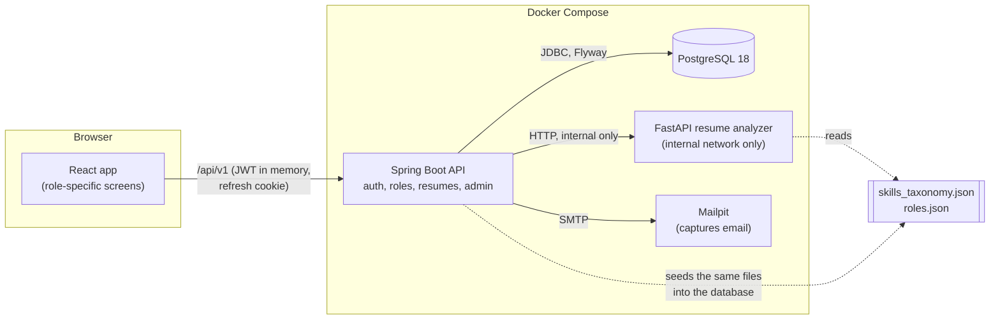

# PlaceWise

An AI-assisted placement preparation and recruitment platform for colleges. Students from every
department prepare for technical and non-technical placements, see which skills they are missing for
the roles they want, and are matched to campus drives. Faculty mentor assigned students, the
Training and Placement (T&P) team manages drives and shortlists, administrators manage accounts, and
recruiters see only approved candidates.

**Milestone 1 (v0.1.0)** builds every screen for every role and a real backend for accounts, the
role catalogue and the resume analyzer. Everything else is a finished screen with an honest empty
state and no invented data. [docs/milestone-1-status.md](docs/milestone-1-status.md) lists every
feature from the project overview and says whether it is real, UI only, or future.

| | |
| --- | --- |
|  |  |
|  |  |
|  |  |

## What is real in this release

- **Accounts and security:** student registration, sign-in, rotating refresh cookies, password
  reset, role-based route guards and API authorization, login rate limiting, security headers and a
  Content-Security-Policy.
- **Resume analyzer:** paste resume text and get sections, skills with the exact words they came
  from, a skill gap for each role, suggestions with reasons, and the ability to correct the result.
  It uses fixed rules and word lists, so it can never invent a skill ([how it works](docs/resume-analyzer.md)).
- **Role catalogue and career interests:** 14 roles and 453 skills, seeded from one source.
- **Administration:** create staff accounts (the person chooses their own password from an emailed
  link), activate and deactivate, resend invites, and a read-only permission matrix built from the
  rules the API actually enforces.

## Technology

| Layer | Choice | Why |
| --- | --- | --- |
| Web | React 19, TypeScript (strict), Vite | Typed components and fast feedback; the types are generated from the API so the two cannot drift. |
| Styling | Tailwind CSS v4 with design tokens, shadcn/ui on Radix | Tokens keep light and dark consistent; Radix gives keyboard and screen-reader behaviour for free. |
| Data and forms | TanStack Query and Table, React Hook Form, Zod | Caching and server state without hand-written loading code; one schema validates a form. |
| Charts and editor | Recharts, Monaco | Recharts for the T&P trend; Monaco only on the coding screen, loaded on demand. |
| API | Spring Boot 4, Java 21, Spring Security, JPA, Flyway | Mature security and validation, and every schema change is a reviewed migration. |
| Database | PostgreSQL 18 | See below. |
| AI service | Python 3.12, FastAPI, spaCy (PhraseMatcher), RapidFuzz | Rules and word lists make results explainable and repeatable, with no model to hallucinate. |
| Tests | JUnit with Testcontainers, pytest, Vitest, Playwright, axe-core | Real database in API tests; real browser for the flows that matter. |
| Local infrastructure | Docker Compose, Mailpit | One command starts everything; emails are caught instead of sent. |

**Why PostgreSQL, not MySQL.** The proposal listed MySQL, with MongoDB as an option for
semi-structured data. PostgreSQL covers both in one database. Resume analyses are stored as JSONB
with an index, so no document database is needed, and version 18 generates time-ordered UUIDs
(`uuidv7()`) for every primary key natively. Constraints and partial indexes are stronger too, which
suits data that decides who is shortlisted.

## Architecture



The browser never talks to the analyzer. The API validates the request, calls the analyzer over the
internal network, and stores the result. The skill and role catalogue has one source: the JSON files
the analyzer reads, which a migration also loads into the database.

## Prerequisites

| Tool | Version |
| --- | --- |
| Node.js | 22 or newer |
| pnpm | 12 |
| JDK | 21 (Temurin), with `JAVA_HOME` set |
| uv | 0.10 or newer (installs Python 3.12 for the analyzer) |
| Docker Desktop | running, for PostgreSQL, Mailpit and the Testcontainers tests |

## Setup

```sh
cp .env.example .env        # then fill in every value
cd apps/web && pnpm install && pnpm exec playwright install chromium
```

Use any values for the passwords; `JWT_SECRET` must be at least 32 bytes
(`openssl rand -hex 32` works). `ADMIN_EMAIL` and `ADMIN_PASSWORD` become the first administrator.

## Run

The whole backend in Docker, and the web app with hot reload:

```sh
docker compose up -d --build            # postgres, mailpit, api, ai-service
cd apps/web && pnpm dev                 # http://localhost:5173
```

| Address | What |
| --- | --- |
| http://localhost:5173 | the web app |
| http://localhost:8080/swagger-ui.html | the API documentation |
| http://localhost:8025 | Mailpit, where invitation and password-reset emails arrive |

Each service restarts by itself unless you stop it. To run an app outside Docker instead
(`./mvnw spring-boot:run` in `apps/api`, `uv run uvicorn app.main:app --port 8000` in
`apps/ai-service`), start only the infrastructure with `docker compose up -d postgres mailpit`.

Create one demo account per role, ready for a walkthrough:

```sh
node scripts/create-demo-users
```

It uses the admin API, so the accounts are real, and prints how to sign in to each. No scores,
drives or other records are created. A step-by-step review script is in
[docs/demo-script.md](docs/demo-script.md).

## Tests

```sh
cd apps/web && pnpm lint && pnpm typecheck && pnpm test && pnpm build
cd apps/api && ./mvnw verify                       # starts PostgreSQL with Testcontainers
cd apps/ai-service && uv run ruff check . && uv run mypy app && uv run pytest
cd apps/web && pnpm e2e                            # needs the stack running (docker compose up -d)
```

- `pnpm e2e` runs the whole Playwright suite: sign-in and sessions, the resume analyzer, every role's
  flows, a design audit of every route at 375, 768 and 1280 px in light and dark, and an axe
  accessibility check of every route. It also writes screenshots to `apps/web/e2e/screenshots`
  (not committed).
- `pnpm build && pnpm e2e:csp` serves the production build and fails on any Content-Security-Policy
  violation. Stop the dev server first: both use port 5173.
- CI runs the lint, type, unit and API checks on every push, and the full end-to-end suite against
  the Compose stack on pushes to `main` and on demand.

## Environment variables

Set these in `.env` (copied from `.env.example`). Docker Compose passes them to the containers.

| Variable | Used by | Purpose |
| --- | --- | --- |
| `POSTGRES_DB`, `POSTGRES_USER`, `POSTGRES_PASSWORD` | postgres, api | Database name and credentials. |
| `JWT_SECRET` | api | Signs access tokens. At least 32 bytes; the API will not start without it. |
| `ADMIN_EMAIL`, `ADMIN_PASSWORD` | api, e2e, demo script | The first administrator, created at startup if the email is new. |
| `WEB_ORIGIN` | api | The web address allowed to call the API (CORS) and used in emailed links. |
| `AI_SERVICE_URL` | api | Where the analyzer is, for example `http://ai-service:8000`. |
| `SMTP_HOST`, `SMTP_PORT` | api | Mail server. Mailpit in development. |

Optional settings (Spring Boot maps `APP_AUTH_REFRESH_GRACE` to `app.auth.refresh-grace`, and so on):

| Variable | Default | Purpose |
| --- | --- | --- |
| `APP_AUTH_REFRESH_GRACE` | `10s` | How long a just-rotated refresh token may be presented again (two tabs, a reload). `0s` makes any reuse end the session. |
| `APP_AUTH_INVITE_TTL` | `24h` | How long the set-password link for a new staff account works. |
| `APP_AUTH_RESET_TTL` | `30m` | How long a password-reset link works. |
| `APP_AUTH_REFRESH_TTL` | `7d` | Session length. |
| `APP_COOKIE_SECURE` | `true` | Set `false` only if you serve the app over plain HTTP on a host other than `localhost`. |
| `VITE_API_URL` | empty | Build-time API address when the web app and API are on different origins. Empty means same origin. |

## Project layout

```
apps/web         React app (feature folders under src/features, shared pieces in src/components)
apps/api         Spring Boot API (package by feature: auth, user, admin, student, resume, role, common)
apps/ai-service  FastAPI resume analyzer and its data files
scripts          create-demo-users, bundle-size
docs             milestone status, demo script, security notes, resume analyzer design
```

## More

- [docs/milestone-1-status.md](docs/milestone-1-status.md): every feature, real or not
- [docs/demo-script.md](docs/demo-script.md): a walkthrough for a review
- [docs/security.md](docs/security.md): headers, dependency checks and what to set when deploying
- [docs/resume-analyzer.md](docs/resume-analyzer.md): how the analyzer works and why
- [CLAUDE.md](CLAUDE.md): scope, design system and conventions
